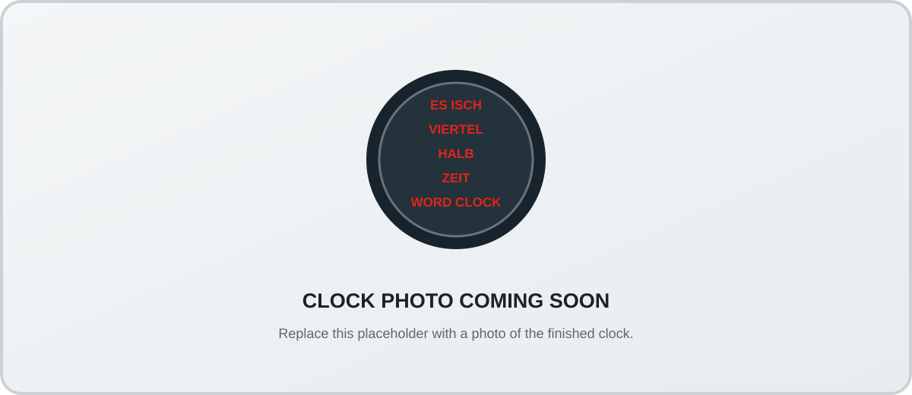
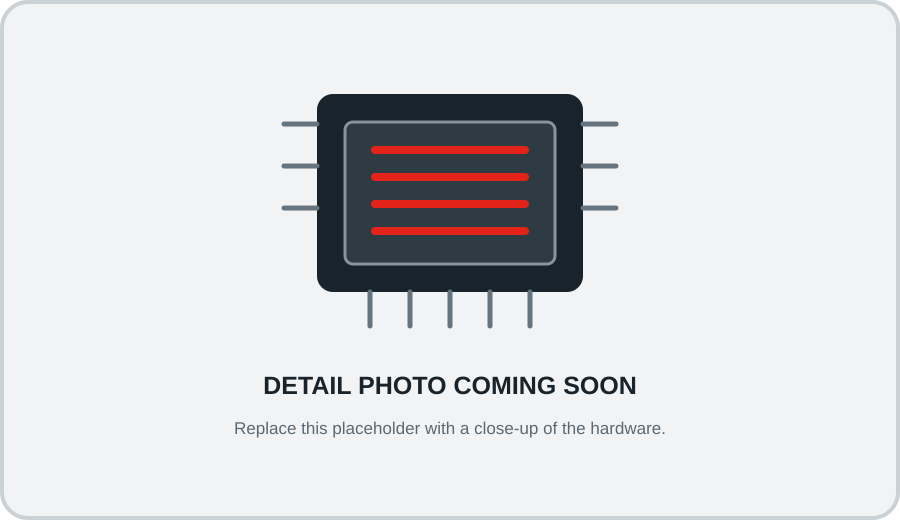

<div align="center">

# Simple Word Clock

**A Swabian word clock, built with Zephyr RTOS.**

[Features](#features) · [Hardware](#hardware) · [Getting started](#getting-started) · [Documentation](#documentation)

</div>

## Project photos

<!-- Replace these placeholders with photos of the finished clock when available. -->
<p align="center">
  
</p>
<p align="center">
  
</p>

## Overview

Simple Word Clock is an open-source LED clock that displays the time in Swabian phrasing. Its firmware is built on Zephyr RTOS and runs on the Adafruit ItsyBitsy RP2040.

## Features

- Swabian word-clock display with animated transitions
- Automatic brightness adjustment using an ambient light sensor
- Adjustable brightness and display color
- Battery-backed real-time clock with configurable time zone and daylight saving
- USB serial shell for configuration and diagnostics

## Hardware

The current build uses an Adafruit ItsyBitsy RP2040, a WS2812B LED strip, a DS3231 real-time clock, and a BH1750 light sensor.

## Getting started

Set up the [Zephyr development environment](https://docs.zephyrproject.org/latest/develop/getting_started/index.html), then create a workspace using this repository as the West manifest:

```sh
mkdir word-clock-workspace
cd word-clock-workspace
git clone https://github.com/AssFactory/SimpleWordClock.git
west init -l SimpleWordClock
west update
west build -s SimpleWordClock -b adafruit_itsybitsy_rp2040
```

For firmware releases, see the [GitHub Releases](../../releases).

To build and publish a release automatically, push a version tag such as
`v1.0.0`. GitHub Actions copies the tag version into `VERSION`, builds the UF2
firmware, and attaches it to the release:

```sh
git tag v1.0.0
git push origin v1.0.0
```

## Documentation

- [User manual (PDF)](docs/SimpleWordClock-User-Manual-A4-Booklet-DE.pdf)
- [User manual (HTML)](docs/SimpleWordClock-User-Manual-DE.html)

## License

Released under the [MIT License](LICENSE).
